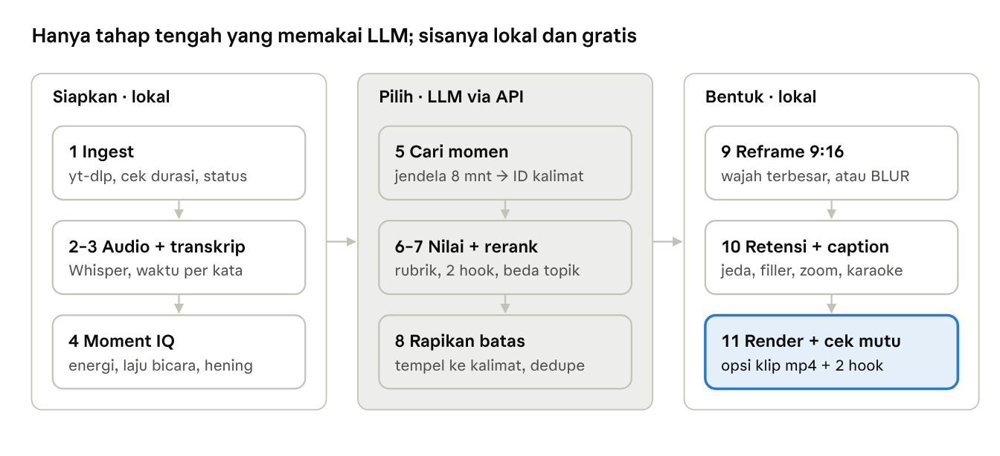
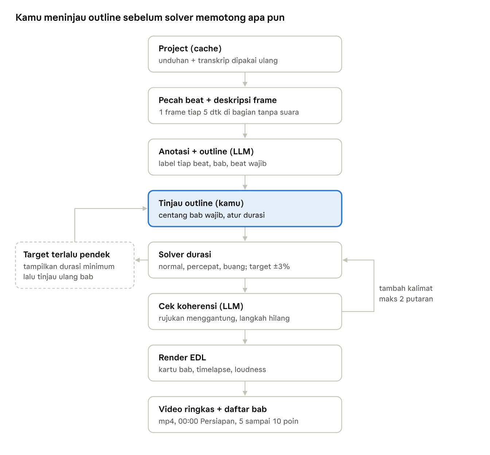

# Cuplik — Blueprint & PRD (bedah miqla.app)

Nov 18, 2026 · @Ranupane

## Ringkasan

**Cuplik** adalah clipper pribadi: tempel link YouTube atau unggah video, keluar 5–12 klip vertikal ber-caption yang sudah diurutkan berdasarkan skor viral. Semua yang dijual miqla.app bisa dibangun dari komponen open-source (yt-dlp, Whisper, LLM, MediaPipe, FFmpeg); yang benar-benar "rahasia" hanya prompt dan cara menggabungkan sinyal untuk skor.

Keputusan utama:

- **Dua mode dalam satu aplikasi:** *Klip* (satu link YouTube → 5–12 opsi Shorts berperingkat, masing-masing dengan 2 variasi hook) dan *Ringkas* (tutorial atau video pembuatan 30 menit–berjam-jam → versi 10 menit atau durasi pilihan, semua langkah inti tetap ada). Keduanya berbagi unduhan dan transkrip yang sama.

- **Jalur termurah:** jalan di Mac pribadi (Apple Silicon) atau VPS, transkripsi lokal (gratis), LLM via API Gemini Flash atau Claude Haiku (beberapa ratus rupiah per video 1 jam), atau Ollama untuk 100% gratis. Mode Ringkas menambah model vision untuk bagian tanpa suara.

- **Bahasa Indonesia kelas satu.** miqla hanya mendukung 7 bahasa dan Indonesia tidak termasuk.

- **Stack:** Next.js (UI) + FastAPI + worker Python + SQLite + Redis/RQ, mengikuti pola OpenShorts (MIT).

- **Jadwal:** MVP mode Klip ±3 minggu kerja sore; mode Ringkas menyusul ±2 minggu, lewat Claude Code dengan cuplik-claude-code-build.md v2.

Design system: [Cuplik Design System](https://claude.ai/artifact/N4cMnfMsZj1rYAgeijkTNS). Prompt AI lengkap ada di file cuplik-prompts.md yang dikirim terpisah.

## Audit v2 sebelum build

Audit menemukan 17 celah di desain v1. Tujuh di antaranya akan memaksa revisi besar kalau baru ketahuan saat build; semuanya sudah diperbaiki di bagian-bagian di bawah, di cuplik-prompts.md v2, dan di cuplik-claude-code-build.md v2. Dokumen ini sekarang mencakup dua mode: **Klip** (satu link → beberapa opsi Shorts) dan **Ringkas** (video panjang → versi singkat dengan durasi pilihan).

| \#  | Celah di v1                                      | Akibat bila dibiarkan                                    | Perbaikan v2                                                           | Berat  |
|-----|--------------------------------------------------|----------------------------------------------------------|------------------------------------------------------------------------|--------|
| 1   | Skor dinilai per batch, tidak dibandingkan       | Urutan klip terasa acak                                  | Tahap **rerank**: semua finalis dibandingkan dalam satu panggilan      | Tinggi |
| 2   | Tidak ada keragaman topik                        | 12 opsi bisa membahas hal yang sama                      | Label topik per klip, maks 2 klip per topik                            | Tinggi |
| 3   | Overlap jendela 60 dtk, klip boleh 180 dtk       | Momen panjang terpotong di batas jendela                 | Overlap = panjang klip maksimum                                        | Tinggi |
| 4   | Tanda baca Whisper bahasa Indonesia sering minim | "Kalimat" 200 kata, batas klip kasar                     | Aturan segmentasi: jeda ≥0,6 dtk, maks 25 kata, gabung \<3 kata        | Tinggi |
| 5   | Retensi hanya caption + hook                     | Penonton pergi di detik 3–10                             | **Paket retensi** (bagian khusus di bawah)                             | Tinggi |
| 6   | Crop dinamis lewat sendcmd FFmpeg                | Paling rawan bug dan lama di-debug                       | Pipa frame Python: decode → crop NumPy → encode                        | Tinggi |
| 7   | Satu video = satu job                            | Pakai dua mode berarti unduh dan transkrip ulang         | Model **Project → banyak Output**; ingest & transkrip di-cache         | Tinggi |
| 8   | Whisper berhalusinasi di bagian musik/hening     | Caption berisi kalimat palsu                             | VAD, condition_on_previous_text=False, filter n-gram berulang          | Sedang |
| 9   | Satu teks hook per klip                          | Tidak ada pilihan untuk dites                            | 2 variasi hook + 2 judul per klip                                      | Sedang |
| 10  | Pelacakan pembicara aktif di MVP                 | Risiko jadwal terbesar                                   | MVP: wajah terbesar + BLUR; pembicara aktif di v1.1                    | Sedang |
| 11  | Volume keluaran tidak dinormalisasi              | Klip satu keras, satu pelan                              | Loudness −14 LUFS, true peak −1 dB                                     | Sedang |
| 12  | Tidak ada pemeriksaan mutu otomatis              | Klip rusak ikut diunduh                                  | QC: durasi, frame hitam, audio senyap, caption di luar area aman       | Sedang |
| 13  | Editor caption baru di v2                        | Salah eja istilah Arab ikut terbakar ke video            | Editor caption masuk MVP                                               | Sedang |
| 14  | Tidak ada umpan balik                            | Kualitas tidak pernah naik                               | Tombol suka/tidak + alasan; klip disukai jadi contoh di prompt         | Sedang |
| 15  | Batas platform tidak dijaga                      | Klip \>3 menit tidak dianggap Short                      | Batas keras 180 dtk; peringatan 60 dtk bila memakai musik berhak cipta | Rendah |
| 16  | yt-dlp sering rusak saat YouTube berubah         | Ingest gagal tiba-tiba                                   | Update otomatis harian + pesan error yang jelas                        | Rendah |
| 17  | Prompt tidak punya data uji                      | Perubahan prompt bisa menurunkan kualitas tanpa ketahuan | Golden set 10 video + skrip make eval                                  | Rendah |

Batas platform di \#15 bersumber dari aturan YouTube: [Shorts maksimal 3 menit sejak 15 Oktober 2024](https://www.descript.com/blog/article/how-long-can-youtube-shorts-be), dan [Shorts dengan musik berhak cipta dibatasi 60 detik](https://piktochart.com/blog/how-long-youtube-shorts/).

## Bedah miqla.app

miqla adalah "AI clip generator" kelas Opus Clip/Klap: satu video panjang → sampai 12 klip vertikal berperingkat dengan skor viral 0–10, caption, dan judul otomatis. Dibedah dari halaman publik ([beranda](https://miqla.app/), [panduan](https://miqla.app/guides/how-to-use-miqla), [daftar panduan](https://miqla.app/guides)); kode dan API privatnya tidak disentuh.

| Aspek          | Yang terlihat di miqla                                                                       | Cara meniru di Cuplik                                                            |
|----------------|----------------------------------------------------------------------------------------------|----------------------------------------------------------------------------------|
| Input          | Link YouTube, TikTok, IG, X, LinkedIn, Twitch; unggah file s.d. 10 GB                        | yt-dlp untuk semua link + unggah chunked                                         |
| Estimasi biaya | Durasi & harga tampil sebelum proses; 1 kredit = 1 menit video; gagal = kredit kembali       | yt-dlp --dump-json untuk durasi; tampilkan perkiraan waktu proses (tanpa kredit) |
| Format         | 9:16, 1:1, 16:9                                                                              | Parameter render FFmpeg                                                          |
| Bahasa         | Auto atau 7 bahasa: EN, ES, PT, DE, FR, HI, RU                                               | Whisper large-v3-turbo: Indonesia, Arab, Jawa ikut                               |
| Panjang klip   | Auto, \<30 dtk, 30–60, 60–90, 90–180                                                         | Rentang dikirim ke prompt LLM + validasi                                         |
| Toggle         | Caption, hook (judul di 3 detik awal), emoji, kata di-highlight, potong hening               | Semua ada di MVP (lihat PRD)                                                     |
| Moment focus   | Teks bebas, mis. "hanya bagian soal harga"                                                   | Disisipkan ke prompt sebagai prioritas                                           |
| Output         | Maks 12 klip, urut terbaik, judul, durasi, skor, thumbnail; tidak di-pad kalau momen sedikit | Sama; LLM boleh mengembalikan lebih sedikit                                      |
| Moment IQ      | Skor tiap detik untuk hook, pacing, emosi, payoff + kurva perhatian                          | Gabungan sinyal audio + teks + LLM (lihat Konsep sistem)                         |
| Reframe        | 9:16 "setiap pembicara tetap di frame"                                                       | MediaPipe/YOLO + active speaker; mode split                                      |
| Variasi        | Reframe, pacing, potongan unik per klip "agar tidak kena flag copy-paste"                    | Tidak ditiru (lihat Catatan hak cipta)                                           |
| Integrasi      | MCP server: buat klip dari ChatGPT/Claude/Gemini                                             | v2: MCP server kecil di FastAPI                                                  |
| Lain           | Video trending yang layak di-clip; menit "tidak kedaluwarsa"                                 | Tidak perlu untuk pemakaian pribadi                                              |

Yang **tidak** diumumkan miqla: model AI yang dipakai, rumus skor viral, gaya caption, batas durasi maksimum, harga per paket. Testimoni di beranda (penghasilan, "0 takedown", "shadowban-safe") tidak bisa diverifikasi dan sebaiknya tidak dijadikan acuan.

Kesimpulan teknis: miqla hampir pasti adalah pipeline yang sama dengan proyek open-source seperti [OpenShorts](https://github.com/mutonby/openshorts) — transkripsi dengan timestamp per kata, LLM memilih dan menilai momen, pelacakan wajah untuk crop vertikal, caption ASS dibakar FFmpeg — dibungkus UI yang rapi dan sistem kredit.

## Konsep sistem

Mode Klip adalah pipeline 11 tahap yang dijalankan worker di belakang layar; UI hanya mengirim job dan mendengarkan progres. Setiap tahap menyimpan hasilnya ke disk, jadi job yang gagal bisa diulang dari tahap terakhir tanpa mengunduh atau mentranskrip ulang.

pipeline mode Klip · 11 tahap dalam 3 kelompok

Biaya hanya muncul di kolom tengah; pindahkan LLM ke Ollama dan seluruh pipeline jadi gratis.

### Tahapan pipeline

1.  **Ingest** — yt-dlp (diperbarui otomatis tiap hari) mengunduh video terbaik ≤1080p, atau file unggahan. --dump-json dulu untuk durasi, judul, status live/privat. Tolak playlist, live yang masih berjalan, video tanpa audio. Hasil disimpan per **Project**, jadi mode Klip dan Ringkas memakai unduhan yang sama.

2.  **Audio** — FFmpeg ekstrak WAV 16 kHz mono untuk transkripsi.

3.  **Transkripsi** — Whisper large-v3-turbo dengan waktu per kata, VAD aktif, condition_on_previous_text=False, glosarium sebagai initial_prompt. Baris yang mengulang n-gram yang sama 3× ditandai halusinasi dan dibuang. Kalimat dipecah dari tanda baca, jeda ≥0,6 dtk, atau maksimal 25 kata; potongan \<3 kata digabung ke tetangganya.

4.  **Sinyal per detik (Moment IQ)** — energi suara, kecepatan bicara, jeda hening, pergantian adegan, kata pemicu hook.

5.  **Cari momen (LLM)** — jendela 8 menit dengan overlap sama dengan panjang klip maksimum; LLM mengusulkan rentang ID kalimat, kalimat hook, dan (opsional) kalimat *cold open*.

6.  **Nilai & kemas (LLM)** — rubrik H/S/P/E/C, label topik, 2 judul, 2 teks hook, keyword, emoji, deskripsi, hashtag.

7.  **Rerank (LLM)** — maksimal 20 finalis dibandingkan sekaligus dalam satu panggilan untuk urutan akhir; aturan keragaman: maks 2 klip per topik.

8.  **Rapikan batas** — tempel ke batas kalimat dan jeda ≥250 ms, buang pengisi di awal, buang duplikat (tumpang-tindih \>30%), ambil sejumlah klip yang diminta (default 8, maks 12).

9.  **Reframe** — MVP: lacak wajah terbesar dengan MediaPipe, mode BLUR bila tidak ada wajah. v1.1: pembicara aktif dan SPLIT.

10. **Retensi & caption** — terapkan paket retensi (bagian di bawah), lalu bangun caption ASS dan overlay hook.

11. **Render & QC** — pipa frame Python ke FFmpeg (H.264 1080×1920 30 fps), audio −14 LUFS, thumbnail; cek otomatis durasi, frame hitam, audio senyap, caption di area aman. Klip yang gagal QC ditandai, bukan disembunyikan.

### Skor viral & Moment IQ

Skor viral miqla adalah "perkiraan untuk memprioritaskan", bukan prediksi views. Cuplik menghitungnya transparan:

\text{viral} = 0.30\\H + 0.25\\S + 0.20\\P + 0.15\\E + 0.10\\C \\+\\ \Delta\_{IQ}

H = hook 3 detik pertama, S = bisa dipahami tanpa konteks, P = payoff/ending jelas, E = intensitas emosi, C = kepadatan (sedikit basa-basi), masing-masing 0–10 dari LLM. ΔIQ = koreksi ±0,5 dari rata-rata kurva Moment IQ di rentang klip dibanding rata-rata seluruh video, supaya klip yang energinya jelas tinggi naik peringkat.

Kurva Moment IQ per detik = 0,35 × energi suara (z-score) + 0,25 × kecepatan bicara (z-score) + 0,20 × kata pemicu + 0,10 × pergantian adegan − 0,10 × hening, lalu dihaluskan jendela 5 detik dan dinormalkan 0–1. Kurva ini juga dikirim ringkas ke LLM di tahap 5 (cari momen) sebagai petunjuk "di sini ada lonjakan".

### Reframe yang menjaga pembicara

- Mulai v1.1, pembicara aktif = wajah yang bukaan mulutnya paling berkorelasi dengan energi audio dalam jendela 1 detik (cukup tanpa diarization untuk podcast 1–2 orang).

- Jendela crop bergerak dengan EMA + zona mati 8% lebar frame, supaya kamera tidak goyang tiap orang menoleh; pindah fokus antar pembicara boleh langsung (hard cut) bila ada jeda ≥ 0,7 detik.

- Dua wajah berjauhan dan bergantian bicara cepat → SPLIT atas-bawah. Tidak ada wajah (slide, game) → BLUR: video 16:9 di tengah, latar video yang sama di-blur.

### Caption

Kata dikelompokkan 1–3 per tampilan dari timestamp Whisper, ditulis sebagai file ASS dengan efek karaoke; kata kunci dari LLM diwarnai kuning, emoji opsional maks 1 per baris. Hook (judul pendek) tampil 0–3 detik di sepertiga atas. Gaya mengikuti preset di design system (Karaoke, Kotak, Santai + emoji, Satu kata).

### Paket retensi

Penonton memutuskan bertahan atau menggeser dalam 1–3 detik pertama, lalu pergi saat ada jeda atau gambar diam terlalu lama. Paket ini diterapkan otomatis di tahap 10; setiap teknik bisa dimatikan per klip.

| Momen          | Teknik                 | Cara kerja di Cuplik                                                                                                                 | Default                  |
|----------------|------------------------|--------------------------------------------------------------------------------------------------------------------------------------|--------------------------|
| 0–1 dtk        | Kalimat pertama = hook | Rentang klip dimulai di hook_sentence_id, bukan di salam atau "jadi gini"                                                            | Aktif                    |
| 0–3 dtk        | Teks hook di layar     | Kotak putih di sepertiga atas, 8 kata maks, 2 variasi untuk dipilih                                                                  | Aktif                    |
| 0–3 dtk        | *Cold open*            | Satu kalimat payoff (≤3 dtk) diputar duluan, lalu klip mulai dari awal                                                               | Mati (aktifkan per klip) |
| Sepanjang klip | Tanpa jeda mati        | Jeda antar kata \>0,35 dtk dipendekkan jadi 0,12 dtk                                                                                 | Aktif                    |
| Sepanjang klip | Buang kata pengisi     | "eh", "em", "hmm" yang berdiri sendiri dihapus per kata dari timestamp                                                               | Aktif                    |
| Tiap 2–4 dtk   | Perubahan visual       | Zoom halus bergantian 100% ↔ 112% di batas kalimat, 120% singkat pada keyword yang ditekan                                           | Aktif                    |
| Sepanjang klip | Caption karaoke        | 1–3 kata per tampilan, keyword kuning, emoji opsional                                                                                | Aktif                    |
| Akhir          | Berhenti di payoff     | Klip berakhir tepat setelah kalimat payoff, tanpa "oke sekian"; bila kalimat terakhir bisa menyambung ke awal, tandai sebagai *loop* | Aktif                    |
| Seluruh klip   | Audio rata             | Loudness −14 LUFS, true peak −1 dB, kompresi ringan pada suara                                                                       | Aktif                    |
| Panjang        | Durasi ideal           | Default "auto" mengutamakan 35–75 dtk; batas keras 180 dtk                                                                           | Aktif                    |

Default panjang condong ke kisaran ini karena satu studi atas 5.400 Shorts menemukan [video 50–60 detik meraih hampir 22× views dibanding klip di bawah 10 detik](https://piktochart.com/blog/how-long-youtube-shorts/). Klip kajian yang butuh penjelasan utuh tetap boleh sampai 3 menit.

## Mode Ringkas Video

Mode Ringkas mengubah tutorial atau video pembuatan berdurasi 30 menit sampai berjam-jam menjadi satu video dengan durasi target (default 10 menit). Untuk setiap potongan, Cuplik memilih satu dari tiga perlakuan: tampil normal, dipercepat, atau dibuang. Langkah yang ditandai wajib tidak pernah dibuang. Kalau langkah wajib saja sudah melebihi target, Cuplik berhenti dan menyebut durasi minimum yang masuk akal, bukan memaksa memotong inti.

alur mode Ringkas · 8 langkah, 1 titik tinjau, 1 putaran koherensi

Solver hanya memotong setelah bab wajib kamu setujui; kalau target mustahil, alurnya kembali ke tinjauan, bukan memangkas inti diam-diam.

### Pengaturan

| Pengaturan                      | Pilihan                                                                                 | Default  |
|---------------------------------|-----------------------------------------------------------------------------------------|----------|
| Durasi target                   | Menit (3–60) atau persen dari durasi asli                                               | 10 menit |
| Gaya                            | Tutorial (semua langkah), Kajian/kuliah (poin utama), Highlight (bagian paling menarik) | Tutorial |
| Format                          | 16:9, 9:16                                                                              | 16:9     |
| Kecepatan bicara maksimum       | 1,0–1,25×, nada suara tetap                                                             | 1,15×    |
| Timelapse bagian tanpa suara    | 2–8× atau auto                                                                          | Auto     |
| Kartu judul bab + label langkah | Aktif/mati                                                                              | Aktif    |
| Musik saat timelapse            | Dari folder musik bebas royalti milikmu                                                 | Mati     |
| Fokus                           | Teks bebas, mis. "bagian finishing saja yang detail"                                    | Kosong   |

### Cara kerja

1.  **Pakai ulang Project** — unduhan dan transkrip dari mode Klip dipakai lagi; tidak ada proses ulang.

2.  **Pecah jadi beat** — tiap kalimat bicara jadi satu beat; bagian tanpa suara dipotong di pergantian adegan, maksimal 20 dtk per beat. Tiap beat diberi skor aktivitas gambar (selisih antar frame).

3.  **Deskripsi visual** — untuk beat tanpa suara diambil 1 frame tiap 5 dtk, di bagian bicara 1 frame tiap 15 dtk, lebar 512 px (1024 px untuk tutorial layar). Model vision menulis apa yang terlihat, mis. "mengamplas sisi papan". Dikirim 16 frame per panggilan. Opsi lain: unggah seluruh video ke Gemini; [Gemini 2.5 Pro bisa memproses ±6 jam video pada resolusi rendah](https://developers.googleblog.com/gemini-2-5-video-understanding/). Ini disediakan sebagai opsi, bukan default, karena mengikat ke satu penyedia dan lebih mahal untuk video panjang.

4.  **Anotasi (LLM, per 15 menit)** — tiap beat diberi satu label dari tabel nilai di bawah, plus angka/setelan yang disebut.

5.  **Outline (LLM, sekali)** — daftar bab = langkah, masing-masing dengan tujuan, beat wajib (instruksi pertama, angka/setelan, shot hasil ≥2 dtk), dan tingkat penting.

6.  **Tinjau outline (oleh kamu)** — bab tampil sebagai daftar centang; tandai wajib atau boleh dipangkas, lalu lanjut. Langkah ini opsional, tapi inilah jaminan inti tidak hilang.

7.  **Solver durasi (kode)** — memilih normal/percepat/buang per beat sampai total pas dengan target ±3%.

8.  **Cek koherensi (LLM)** — membaca naskah hasil dan menandai rujukan yang menggantung ("seperti tadi", "yang barusan") atau langkah yang tiba-tiba muncul; solver menambah kalimat yang dibutuhkan atau memasang teks jembatan. Maksimal 2 putaran.

9.  **Render dari EDL** — potongan disambung dengan crossfade audio 80 ms, percepatan memakai setpts + atempo, lencana "⏩ 4×" saat timelapse, kartu judul bab 2 dtk, loudness −14 LUFS.

10. **Keluaran** — video mp4, daftar bab siap tempel ke deskripsi YouTube (00:00 Persiapan), ringkasan teks 5–10 poin, dan tombol "buat Shorts dari hasil ringkasan".

### Nilai tiap jenis beat

| Label                                   | Nilai dasar | Perlakuan default                              |
|-----------------------------------------|-------------|------------------------------------------------|
| Langkah inti (instruksi)                | 1,0         | Wajib untuk kalimat instruksi pertama tiap bab |
| Angka, ukuran, setelan                  | 1,0         | Wajib                                          |
| Hasil / sebelum-sesudah                 | 0,9         | Wajib, minimal 2 dtk per bab                   |
| Penjelasan alasan                       | 0,6         | Dipertahankan bila muat                        |
| Pengerjaan manual tanpa suara           | 0,4         | Timelapse 2–8×                                 |
| Pengulangan                             | 0,2         | Biasanya dibuang                               |
| Salah lalu diulang                      | 0,1         | Dibuang, versi yang benar disimpan             |
| Obrolan lepas                           | 0,1         | Dibuang                                        |
| Menunggu / diam                         | 0,05        | Dibuang atau 8×                                |
| Intro, outro, sponsor, ajakan subscribe | 0           | Dibuang; 1 kalimat pembuka boleh untuk konteks |

### Solver durasi

1.  Masukkan semua beat wajib pada 1×. Kalau totalnya melebihi target, naikkan kecepatan bicara sampai batas dan ubah beat visual wajib menjadi timelapse. Masih melebihi → berhenti dan tampilkan "Durasi minimum agar semua langkah tetap ada: 14:20", dengan pilihan menerima durasi itu atau menandai bab yang boleh dipangkas.

2.  Sisa anggaran diisi beat lain, diurutkan dari nilai per detik tertinggi. Beat visual panjang dipercepat sampai maksimal ±4 dtk per 30 dtk aslinya.

3.  Buang potongan terisolasi \<1,2 dtk (gambar terasa melompat) dan satukan potongan yang berjarak \<0,5 dtk.

4.  Ulangi sampai total di dalam target ±3%.

### Batas yang perlu diketahui

- Paling akurat untuk tutorial yang dinarasikan. Video pembuatan tanpa suara sama sekali bergantung pada deskripsi vision, jadi tinjau outline sebelum render.

- Tutorial layar (coding, software) butuh frame 1024 px agar angka dan setelan di layar terbaca benar.

- MVP tidak menambah narasi suara AI; jembatan antar bab berupa teks. Narasi TTS masuk v2.

## PRD

**Tujuan:** (1) dari satu link YouTube ≤90 menit, dapat 5–12 opsi Shorts yang membuat penonton bertahan, siap posting dalam ≤15 menit tanpa membuka editor video; (2) dari tutorial 30 menit–3 jam, dapat versi ringkas berdurasi pilihan yang tetap memuat semua langkah inti. Biaya API \< Rp2.000 per video untuk Klip dan \< Rp5.000 untuk Ringkas.

**Pengguna:** satu orang (aku) — pengajar bahasa Arab dan founder KukerjainAja yang membuat konten edukasi dan bisnis, menguji di tablet dan Mac. Tidak ada multi-user, tidak ada pembayaran.

### User stories

- [ ] Aku tempel link YouTube dan langsung melihat durasi, bahasa, perkiraan waktu proses, lalu memilih mode Klip, Ringkas, atau keduanya.

- [ ] Di mode Klip aku pilih format, panjang, jumlah klip, gaya caption, dan menulis "moment focus".

- [ ] Aku menutup tab, lalu kembali dan melihat progres tiap tahap yang akurat.

- [ ] Aku melihat grid opsi klip urut skor, dengan alasan skor dan 2 variasi hook yang bisa kupilih.

- [ ] Aku memperbaiki salah eja caption (mis. istilah Arab) lalu render ulang klip itu saja.

- [ ] Aku menyalakan/mematikan teknik retensi per klip (cold open, zoom, potong hening).

- [ ] Aku memberi suka/tidak pada klip agar pilihan berikutnya makin cocok seleraku.

- [ ] Di mode Ringkas aku menentukan durasi target, meninjau outline langkah, menandai bab wajib, lalu render.

- [ ] Kalau target terlalu pendek, aku diberi tahu durasi minimum yang masih memuat semua langkah.

- [ ] Aku mengunduh hasil beserta judul, deskripsi, hashtag, dan daftar bab siap tempel.

### Fitur

| Fitur                                                                | MVP    | v1.1                   | v2          | Catatan                       |
|----------------------------------------------------------------------|--------|------------------------|-------------|-------------------------------|
| Project: satu unduhan + transkrip untuk banyak output                | Ya     |                        |             | Fondasi dua mode              |
| Input link (yt-dlp) + unggah file                                    | Ya     |                        |             | Unggah s.d. 4 GB              |
| Bahasa auto + Indonesia, Inggris, Arab                               | Ya     |                        |             | Whisper multibahasa           |
| **Klip:** format 9:16                                                | Ya     | 1:1, 16:9              |             |                               |
| **Klip:** panjang auto/\<30/30–60/60–90/90–180 dtk, jumlah 3–12      | Ya     |                        |             | Default auto, 8 klip          |
| **Klip:** moment focus                                               | Ya     |                        |             | Masuk prompt                  |
| **Klip:** skor + rincian rubrik + rerank + keragaman topik           | Ya     |                        |             |                               |
| **Klip:** 2 variasi hook & judul                                     | Ya     |                        |             |                               |
| **Klip:** paket retensi (hook, jeda, filler, zoom, payoff, loudness) | Ya     |                        |             | Cold open mati secara default |
| **Klip:** reframe wajah terbesar + BLUR                              | Ya     | Pembicara aktif, SPLIT | SCREENCAST  |                               |
| Caption karaoke + highlight + emoji                                  | Ya     | Preset lain            | Font kustom | ASS + FFmpeg                  |
| Editor teks caption + render ulang 1 klip                            | Ya     |                        |             | Dimajukan dari v2             |
| Glosarium koreksi kata                                               | Ya     |                        |             | Istilah Arab                  |
| QC otomatis                                                          | Ya     |                        |             |                               |
| Suka/tidak + alasan → contoh di prompt                               | Ya     |                        |             |                               |
| Kurva Moment IQ                                                      | Tampil | Seret batas klip       |             |                               |
| **Ringkas:** durasi target, gaya, outline yang bisa ditinjau         |        | Ya                     |             | Fase 5 build                  |
| **Ringkas:** timelapse, kartu bab, daftar bab YouTube                |        | Ya                     |             |                               |
| **Ringkas:** EditTimeline (ubah normal/percepat/buang per beat)      |        | Ya                     |             |                               |
| **Ringkas:** narasi suara AI penjembatan                             |        |                        | Ya          | TTS                           |
| B-roll otomatis, musik latar Klip                                    |        |                        | Ya          |                               |
| Unggah langsung ke YouTube                                           |        |                        | Ya          | YouTube Data API              |
| MCP server, antrean batch                                            |        |                        | Ya          |                               |

### Bukan tujuan

- Multi-user, login, kredit, pembayaran.

- Mengubah video orang lain agar lolos deteksi duplikat platform.

- Model AI buatan sendiri; semua memakai model siap pakai.

### Kriteria sukses

- **Klip:** ≥3 dari 5 klip teratas layak posting tanpa diedit (dinilai sendiri pada golden set 10 video).

- **Klip:** video 60 menit selesai ≤15 menit di Mac M-series.

- **Klip:** batas klip tidak pernah memotong di tengah kata; caption sinkron ±100 ms.

- **Caption:** salah kata ≤8% sebelum diedit, 0 setelah editor caption.

- **Ringkas:** durasi hasil dalam target ±3%, dan 100% bab yang ditandai wajib muncul di hasil.

- **Ringkas:** pada 5 tutorial uji, aku bisa mengikuti dan mengulang langkahnya hanya dari versi ringkas.

- **Ringkas:** video 2 jam selesai ≤30 menit di Mac M-series (tanpa unggah video penuh ke Gemini).

## Arsitektur & tech stack

Tiga proses di satu docker compose: web (Next.js), API (FastAPI), worker (Python + RQ), dengan Redis sebagai antrean dan SQLite + folder data/ sebagai penyimpanan. Bisa juga jalan langsung di Mac tanpa Docker agar Whisper memakai GPU Apple (MLX).

| Lapisan              | Pilihan                                                                                        | Alasan                                           |
|----------------------|------------------------------------------------------------------------------------------------|--------------------------------------------------|
| UI                   | Next.js 15 + Tailwind v4 + shadcn/ui, token dari design system                                 | SSE untuk progres                                |
| API                  | FastAPI + SQLModel + SQLite                                                                    | Satu file DB, tanpa server DB                    |
| Antrean              | Redis + RQ (1 worker, konkurensi 1)                                                            | Video berat; satu per satu cukup                 |
| Unduh                | yt-dlp (update harian) + ffprobe                                                               | Semua platform di satu alat                      |
| Transkripsi          | faster-whisper large-v3-turbo (Linux) / mlx-whisper (Mac)                                      | Gratis, lokal, waktu per kata                    |
| LLM teks             | Gemini Flash-Lite terbaru atau Claude Haiku via API; Ollama (Qwen 2.5 7B+) sebagai opsi gratis | JSON terstruktur; model \<7B sering merusak JSON |
| LLM vision (Ringkas) | Gemini Flash atau Claude Haiku dengan gambar; Qwen2.5-VL via Ollama sebagai opsi gratis        | Deskripsi frame bagian tanpa suara               |
| Visi lokal           | MediaPipe Face Detection, PySceneDetect, OpenCV                                                | Ringan, jalan di CPU                             |
| Render               | Pipa frame Python → FFmpeg + libass; VideoToolbox/NVENC bila ada                               | Crop dinamis tanpa sendcmd                       |
| Penyimpanan          | data/projects/\<id\>/ (source, audio, transcript, signals) + outputs/\<id\>/ per hasil         | Tiap tahap bisa diulang, cache dipakai bersama   |

### Model data (SQLite)

- **Project** — id, source_url, title, duration_s, language, ingest_status, transcript_status, created_at. Satu per video.

- **Output** — id, project_id, mode (clips/condense), settings (JSON), status (queued/running/awaiting_review/done/failed), stage, progress, error, created_at.

- **Clip** — id, output_id, rank, start_s, end_s, topic, titles (JSON, 2), hook_options (JSON, 2), hook_choice, description, hashtags, score, rubric (JSON), reason, keywords, emoji, retention (JSON: toggle per teknik), caption_overrides (JSON), layout, file_path, thumb_path, qc (JSON), rating (up/down/null), rating_note.

- **Beat** (Ringkas) — id, output_id, start_s, end_s, kind (speech/visual), text, visual_desc, label, importance, chapter_id, decision (keep/speed/drop), speed, locked (boleh diubah user).

- **Chapter** (Ringkas) — id, output_id, order, title, goal, required (bool), kept_s.

- **Preference** — default per mode + preset caption.

- **GlossaryTerm** — salah → benar, juga dipakai sebagai initial_prompt Whisper.

### API

| Method | Path                         | Fungsi                                                           |
|--------|------------------------------|------------------------------------------------------------------|
| POST   | /api/probe                   | Cek link: durasi, judul, bahasa tebakan, boleh/tidak             |
| POST   | /api/uploads                 | Unggah file (chunked, resumable)                                 |
| POST   | /api/projects                | Buat Project dari link atau upload_id (ingest + transkrip mulai) |
| POST   | /api/projects/{id}/outputs   | Buat Output: mode = clips atau condense + settings               |
| GET    | /api/outputs/{id}            | Status + klip atau bab                                           |
| GET    | /api/outputs/{id}/events     | SSE progres per tahap                                            |
| GET    | /api/projects/{id}/signals   | Kurva Moment IQ                                                  |
| PATCH  | /api/clips/{id}              | Ubah batas, hook terpilih, caption, toggle retensi, rating       |
| POST   | /api/clips/{id}/render       | Render ulang satu klip                                           |
| GET    | /api/outputs/{id}/outline    | Outline bab (Ringkas) untuk ditinjau                             |
| PUT    | /api/outputs/{id}/outline    | Simpan bab wajib/opsional, lalu lanjut solver                    |
| PATCH  | /api/beats/{id}              | Kunci keputusan normal/percepat/buang per beat                   |
| POST   | /api/outputs/{id}/solve      | Hitung ulang EDL untuk durasi target baru                        |
| GET    | /api/outputs/{id}/export.zip | Semua file + teks siap tempel                                    |
| POST   | /api/outputs/{id}/retry      | Ulang dari tahap yang gagal                                      |

### Struktur folder

cuplik/  
web/ \# Next.js  
api/app/ \# FastAPI: main.py, routes/, models.py, sse.py  
worker/pipeline/  
common/ ingest.py audio.py transcribe.py segment.py signals.py llm.py qc.py  
clips/ moments.py scoring.py rerank.py boundaries.py reframe.py retention.py captions.py render.py  
condense/ beats.py vision.py annotate.py outline.py solver.py coherence.py edl_render.py  
runner.py \# menjalankan tahap, cache, retry  
worker/prompts/ \# isi dari cuplik-prompts.md v2  
eval/ \# golden set + skrip make eval  
data/ \# projects/ dan outputs/ (gitignore)  
docker-compose.yml Makefile .env.example

### Perkiraan biaya per video 60 menit

Transkripsi, sinyal, reframe, dan render jalan lokal: Rp0. **Klip:** LLM ±80 ribu token masuk + 12 ribu keluar untuk cari momen, nilai, dan rerank; dengan Gemini Flash-Lite kira-kira di bawah Rp1.000. **Ringkas** video 2 jam: ±700–1.000 frame kecil ke model vision + anotasi teks; kira-kira Rp2.000–5.000 dengan model Flash, Rp0 dengan Ollama (jauh lebih lambat). Angka harga ini perkiraan; cek halaman harga penyedia sebelum memilih.

## Prompt AI & roadmap build

Ada sepuluh prompt di cuplik-prompts.md, semuanya mengembalikan JSON yang divalidasi kode:

| Prompt            | Mode     | Kapan dipakai                   | Output                                                                                           |
|-------------------|----------|---------------------------------|--------------------------------------------------------------------------------------------------|
| moment_finder     | Klip     | Tiap jendela transkrip 8 menit  | Rentang ID kalimat, kalimat hook, kalimat cold open opsional                                     |
| scorer            | Klip     | Per batch 6 kandidat            | Rubrik H/S/P/E/C, topik, 2 judul, 2 hook, alasan, keyword, emoji, deskripsi, hashtag, saran trim |
| reranker          | Klip     | Sekali, maks 20 finalis         | Urutan akhir + alasan singkat                                                                    |
| caption_polish    | Keduanya | Hanya potongan terpilih         | Perbaikan ejaan tanpa mengubah susunan                                                           |
| frame_describer   | Ringkas  | 16 frame per panggilan (vision) | Satu kalimat aksi per frame + teks penting di layar                                              |
| beat_annotator    | Ringkas  | Per 15 menit beat               | Label per beat + angka/setelan yang disebut                                                      |
| outline_builder   | Ringkas  | Sekali per video                | Bab, tujuan, beat wajib, tingkat penting                                                         |
| coherence_checker | Ringkas  | Setelah solver, maks 2 putaran  | Rujukan menggantung, langkah hilang, teks jembatan                                               |
| condense_summary  | Ringkas  | Sekali di akhir                 | Judul, deskripsi, 5–10 poin ringkasan                                                            |
| json_repair       | Keduanya | Bila output tidak valid, 1x     | JSON yang sudah diperbaiki                                                                       |

Dua prinsip yang membuat hasilnya stabil: LLM hanya memilih **ID kalimat** (detik dihitung kode dari timestamp Whisper, jadi tidak ada waktu karangan), dan **transkrip dibungkus tag sebagai data tak tepercaya** — kalau ada orang di video berkata "abaikan instruksi", pipeline tidak terpengaruh. Inilah sisi "prompt injection" yang perlu dijaga di aplikasi seperti ini.

### Roadmap

Dibangun lewat Claude Code memakai cuplik-claude-code-build.md; tiap fase berhenti untuk dicek.

1.  **Fase 0 — Kerangka** (1 sore): docker compose, model Project/Output, token design system, SSE dummy, golden set disiapkan.

2.  **Fase 1 — Project: ingest → transkrip** (2–3 sore): probe link, unggah, Whisper + anti-halusinasi + segmentasi kalimat, glosarium, halaman progres.

3.  **Fase 2 — Klip: pilih momen** (3 sore): Moment IQ, cari momen, nilai, rerank + keragaman, rapikan batas, make eval.

4.  **Fase 3 — Klip: bentuk video** (4 sore): reframe wajah terbesar + BLUR, paket retensi, caption ASS, render pipa frame, QC, grid hasil, unduh ZIP.

5.  **Fase 4 — Klip: kontrol** (2–3 sore): editor caption, pilih hook, toggle retensi, render ulang 1 klip, rating, preferensi. **MVP mode Klip selesai di sini.**

6.  **Fase 5 — Ringkas** (5–6 sore): beat, frame vision, anotasi, outline + halaman tinjau, solver, koherensi, render EDL, EditTimeline, daftar bab.

7.  **Fase 6 — v1.1/v2**: pembicara aktif & SPLIT, kurva Moment IQ interaktif, narasi TTS, B-roll, unggah ke YouTube, MCP server, antrean batch.

Uji kualitas memakai golden set yang dibuat di Fase 0: 10 video untuk mode Klip dan 5 tutorial untuk mode Ringkas, masing-masing dengan catatan "klip/bab yang seharusnya ada". make eval menjalankan pipeline dan melaporkan berapa yang tertangkap. Setiap perubahan prompt atau bobot dibandingkan dengan angka sebelumnya sebelum dipakai.

## Catatan hak cipta & risiko

Membangun alat dengan fitur serupa itu sah; yang perlu dijaga adalah isi video yang diproses dan merek miqla.

- **Klip video sendiri** (kajian, kelas Arab, konten KukerjainAja) aman. Klip video orang lain butuh izin pemiliknya; YouTube dan TikTok bisa menurunkan klip atau memberi strike walau sudah dipotong dan diberi caption.

- Fitur miqla "variasi unik per klip agar tidak kena flag copy-paste" sengaja tidak dibuat: fungsinya mengelabui deteksi konten duplikat platform.

- Jangan pakai nama, logo, atau teks pemasaran miqla di aplikasi; Cuplik punya identitasnya sendiri.

- yt-dlp melanggar ketentuan layanan YouTube bila dipakai untuk mengunduh video yang bukan milikmu. Untuk video sendiri, unggah file dari YouTube Studio atau folder lokal juga bisa.

- Proyek open-source acuan (OpenShorts, AI-Youtube-Shorts-Generator) berlisensi MIT: boleh dipelajari dan dikutip kodenya dengan mencantumkan lisensi.

### Tentang skill reverse engineering

Repo dengan bintang terbanyak, [reverse-skill](https://www.implicator.ai/offensive-security-skill-pack-github-trending/) (±20 ribu bintang), adalah router keamanan ofensif untuk biner dan pentest, dan README-nya menyuruh agent menulis ulang aturannya sendiri — tidak cocok dan tidak aman dipakai. Skill "reverse-engineer" populer lain (sickn33, ±45 ribu bintang di repo kumpulannya) juga fokus ke IDA/Ghidra. Untuk membedah produk, metode yang dipakai di sini: inventaris fitur dari halaman publik → cocokkan dengan proyek open-source sejenis → rancang ulang sistemnya.

## Sumber

- [miqla.app — beranda](https://miqla.app/)

- [miqla — How to use Miqla](https://miqla.app/guides/how-to-use-miqla)

- [miqla — Guides](https://miqla.app/guides)

- [OpenShorts (GitHub, MIT)](https://github.com/mutonby/openshorts)

- [AI-Youtube-Shorts-Generator (GitHub)](https://github.com/Anil-matcha/AI-Youtube-Shorts-Generator)

- [reverse-skill di GitHub Trending (Implicator)](https://www.implicator.ai/offensive-security-skill-pack-github-trending/)

- [Descript — How long can YouTube Shorts be](https://www.descript.com/blog/article/how-long-can-youtube-shorts-be)

- [Piktochart — How long should YouTube Shorts be in 2026](https://piktochart.com/blog/how-long-youtube-shorts/)

- [Google Developers Blog — Gemini 2.5 video understanding](https://developers.googleblog.com/gemini-2-5-video-understanding/)
